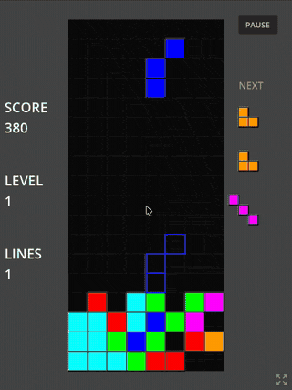
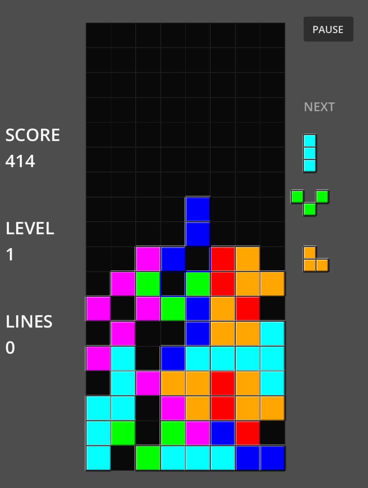
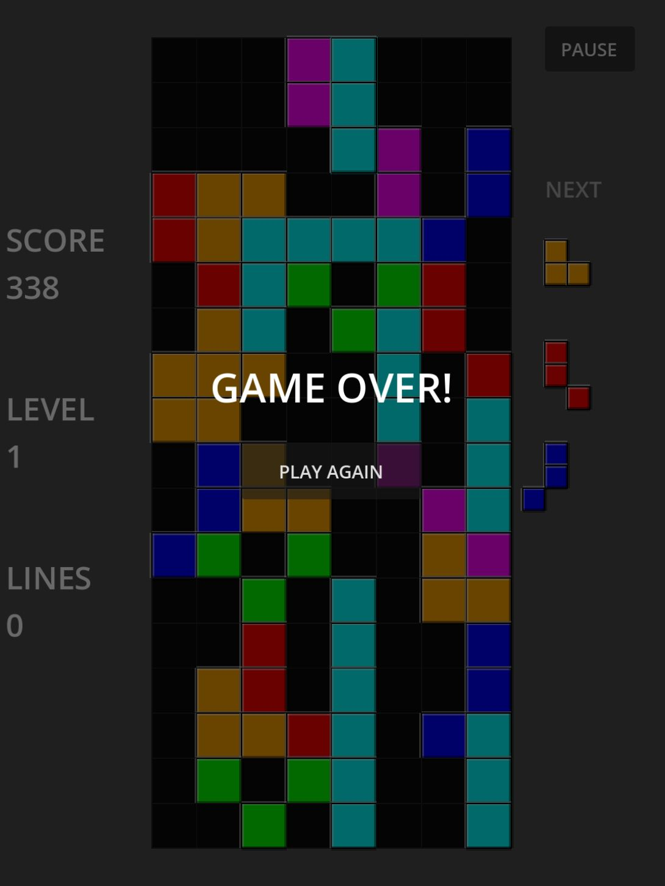

<h1 align="center">TriKing</h1>

<p align="center">Tetris with pieces that come apart.<br>Four of the six pieces are three squares that do not all touch each other, and that changes every decision you make.</p>

<p align="center">
  <a href="https://triking.itch.io/triking"></a>
  
  
  
</p>

<p align="center">
  
</p>

The game is on [itch.io](https://triking.itch.io/triking) and runs in the browser on a laptop or a phone. About 500 people have played it, and a Tetris World Champion played it and wrote a review. This repository holds the full source, and the web build is attached to each [release](https://github.com/pragyaangaur/TriKing/releases).

## Why it is hard

Every Tetris piece is four squares joined edge to edge. TriKing uses three squares, and for four of the six pieces the squares only touch at the corners. Here are all six, drawn as they spawn.

```
I-King  L-King  D-King  V-King  J-Hook  L-Hook
#       #.      #..     #.#     .#      #.
#       ##      .#.     .#.     .#      #.
#               ..#             #.      .#
```

The I-King and L-King are solid, like a normal triomino. The other four are split pieces. Drop a D-King on a flat floor and only its lowest square touches anything. The other two squares float above empty cells, and nothing can ever fill those cells, because a piece cannot slide sideways after it lands. The only clean way to place a split piece is to find a staircase or a notch in the stack that has the same shape, and the board is never tidy enough to offer one for long.

A piece also has no time to settle. It locks on the first gravity tick after it lands, so you cannot slide it into place.

<p align="center">
  
  &nbsp;&nbsp;
  
</p>

<p align="center"><sub>Left: a stack with holes under several floating squares. Right: a lost game at 338 points and 0 lines.</sub></p>

## How a game works

- The board has 8 columns and 18 rows.
- A bag holds eight pieces: two I-Kings, two L-Kings, and one each of the other four. The bag is shuffled and emptied before it refills, so you see each split piece at least once every eight pieces.
- The first piece of a game is always an I-King or an L-King.
- The preview shows the next three pieces, and a ghost outline shows where the current piece will land.
- A piece has three squares, so it can touch at most three rows, and one drop clears at most three lines.

### Scoring

| Lines cleared | Base points |
| --- | --- |
| 1 | 100 |
| 2 | 300 |
| 3 | 500 |

The base points are multiplied by your level. There are three more ways to score:

- A **tri-spin** multiplies the base points by 4. A lock counts as a tri-spin when the last thing you did to the piece was rotate it and it cannot move up, left or right in its final spot, and the lock clears at least one line.
- A **combo** counts the lines you clear on consecutive pieces. The first clear in a chain adds nothing. Each further clear adds 50 times the combo count times the level.
- A **drop** adds 1 point for each row of soft drop and 2 points for each row of hard drop.

You move up a level every 10 lines. Gravity starts at one row per second and gets 0.1 seconds faster per level, down to a floor of 0.1 seconds, which you reach at level 10.

### Controls

| Action | Keyboard | Touch |
| --- | --- | --- |
| Move left or right | Left and Right arrows (hold to repeat) | Drag sideways |
| Soft drop | Down arrow | Drag down |
| Rotate | Up arrow | Tap |
| Hard drop | Enter or Space | Quick swipe down |
| Pause | Pause button on screen | Pause button on screen |

## How it is built

The whole game is one script, [main.gd](main.gd), of about 550 lines of GDScript, and one scene, [main.tscn](main.tscn). The board is a grid of 18 rows and 8 columns that holds either nothing or a colour. Every frame the script redraws that grid, the ghost piece, the preview and the active piece with Godot's `_draw` function, so the picture always matches the grid.

A single state variable (`MENU`, `PLAYING`, `PAUSED` or `GAMEOVER`) decides what each input and each timer is allowed to do. That keeps the game from doing things such as dropping a piece while it is paused. Touch and keyboard input both turn into the same set of moves. The touch code adds up finger movement and moves the piece one column each time the total passes 35 pixels, and it tells a tap from a swipe by distance and time.

The project uses Godot 4.6 with the compatibility renderer, a 600 by 800 viewport and a WebAssembly export without threads, so it needs no special server headers.

## Run it

The easiest way is the [itch.io page](https://triking.itch.io/triking). To run a release, download `TriKing-web.zip` from the [releases page](https://github.com/pragyaangaur/TriKing/releases), unzip it, and serve the folder over HTTP, because browsers do not run WebAssembly from a `file://` address.

```bash
python3 -m http.server -d TriKing-web 8000
```

Then open `http://localhost:8000`.

To run from source, open `project.godot` in Godot 4.6 and press F5. To build the web version yourself, use Project, then Export, then Web. The preset writes to `build/index.html`.

## What it does not do yet

- There is no hold piece.
- The high score is not saved between sessions.
- Rotation goes one way only, and it can kick a piece one column sideways at most.
- There is no lock delay.

## Licence

The source is available to read, and you can run the game for personal use. Commercial use, redistribution and derivative works need written permission. The full text is in [LICENSE](LICENSE).
